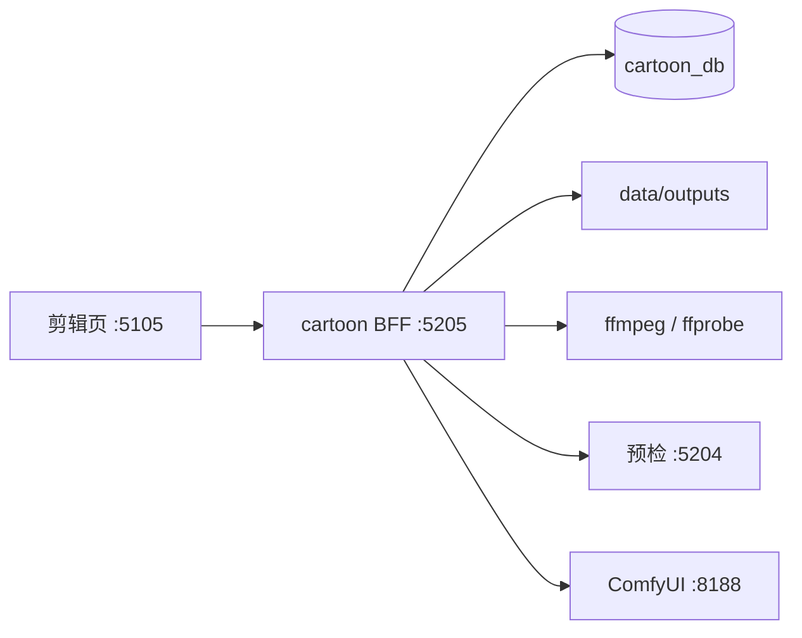

# 漫剧架构关系

菜单名是 AI 视频。浏览器只打漫剧 BFF `:5205`。出图仍先问预检 `:5204`，再提交本机 ComfyUI `:8188`。剪辑不走这两条。新项目的章节从叙事工作台已发布故事包拉取，地址是小说 BFF `:5201` 的 `GET /api/packages/:packageId`。

制作入口是 `/projects/:id/tasks/:taskId`。旧的 `/work`、`/edit`、`/shots/:shotId/generate`、`/shots/:shotId/outputs` 只做重定向。生成和导出的接口没变。

更新故事包走 `POST /api/projects/:id/rebase`。同一章改原来的快照。镜头上已经改过的台词和描述留在视频库。列表上的今日失败来自运维同一份任务摘要。钉扎、生成、提升和导出会写运维审计。

科普项目创建时不传小说编号，`pin_mode` 记为 `local`。知识点正文写在 `cartoon_copy_blocks`，接口是 `/api/projects/:id/copy-blocks`。这类项目不调用叙事工作台，也不新建小说。

模板目录在视频 BFF 的 `videoTemplates.js`。`POST /api/projects/from-template` 只写 `cartoon_db`。需要故事包的模板不在创建时拉小说，项目详情用 `gaps` 标出待补项。

流水线默认图在 `pipelineDefaults.js`。页面通过 `/api/pipelines` 保存节点开关和角色参数，不在视频库实现方案引擎，也不在这一页调用 Skill。已有的编剧、分镜、提示词仍是 `cartoon-script-skill`、`cartoon-storyboard-skill`、`cartoon-prompt-skill`。资产建议、配音时间轴和视频初审分别是 `cartoon-asset-skill`、`cartoon-voice-skill`、`cartoon-review-skill`，确认后才落库。字幕按台词在本地排轴。

批量选题写在 `cartoon_batches`。推进时只在视频库增加文案或分镜，不调用 Skill，也不提交 ComfyUI。创建批次时把当时启用的规则抄进 `rule_snapshot`。

短剧项目 `content_type=ai_short`，和漫剧一样要求钉扎故事包。电商项目 `ai_commerce` 与科普一样是本地文案，不绑定小说。短剧和电商的面板写在 `cartoon_type_panels`。生成前先看面板是否填完，没填完不会创建出图任务。

制作规则在 `cartoon_rules`。审核记录在 `cartoon_reviews`，通过或驳回同步运维审计。资产表保存参考图路径和配音的音色、语速、情绪。

全局页 `/assets/:kind`、`/batches`、`/reviews`、`/versions`、`/exports`、`/agents`、`/templates/:id`、`/pipelines/:contentType` 只汇总视频库里已有的记录，不新开一条不带项目的创作流程。

成片文件写在 `data/outputs/{projectId}/edit/{jobId}/episode.mp4`，并记入 `cartoon_outputs`。产物页用原来的 `GET /api/outputs/:id/file` 播放。
