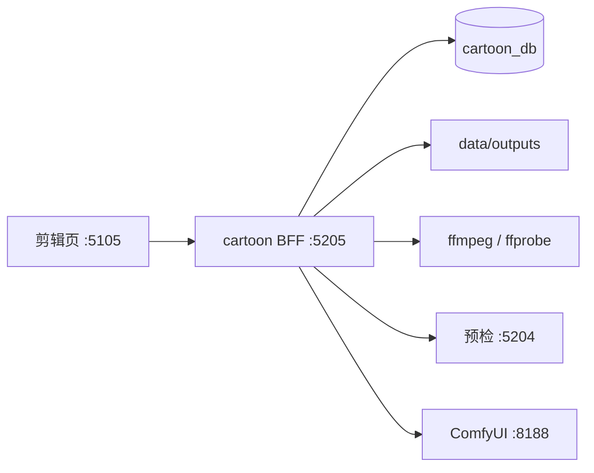

# 漫剧架构关系

浏览器只打漫剧 BFF `:5205`。出图仍先问预检 `:5204`，再提交本机 ComfyUI `:8188`。剪辑不走这两条。

成片文件写在 `data/outputs/{projectId}/edit/{jobId}/episode.mp4`，并记入 `cartoon_outputs`。产物页用原来的 `GET /api/outputs/:id/file` 播放。
