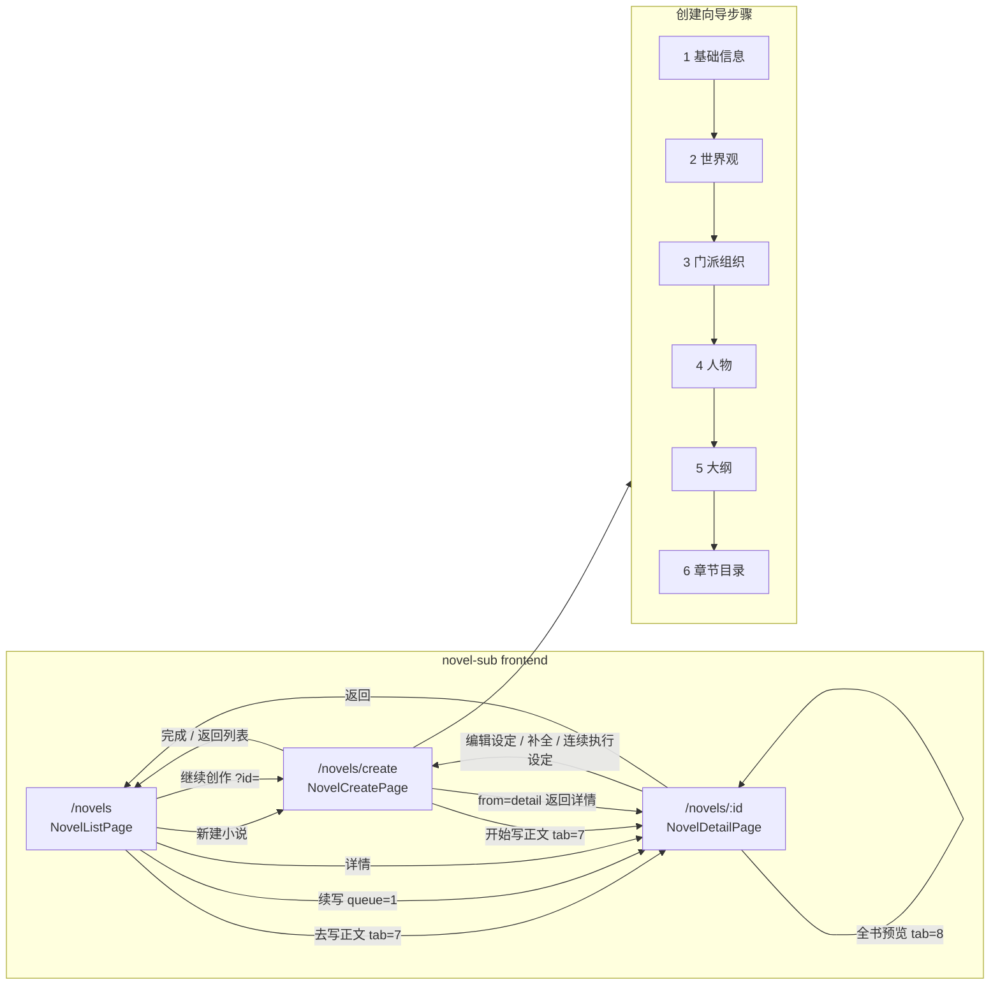
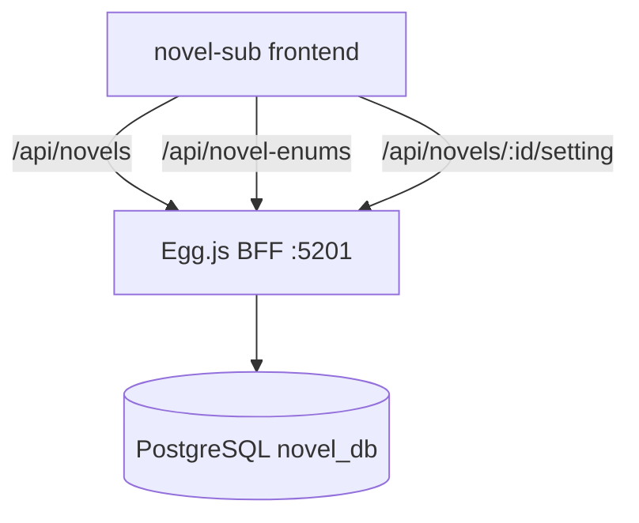
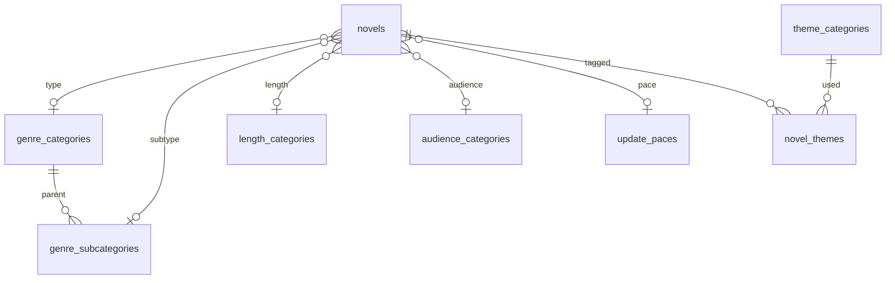
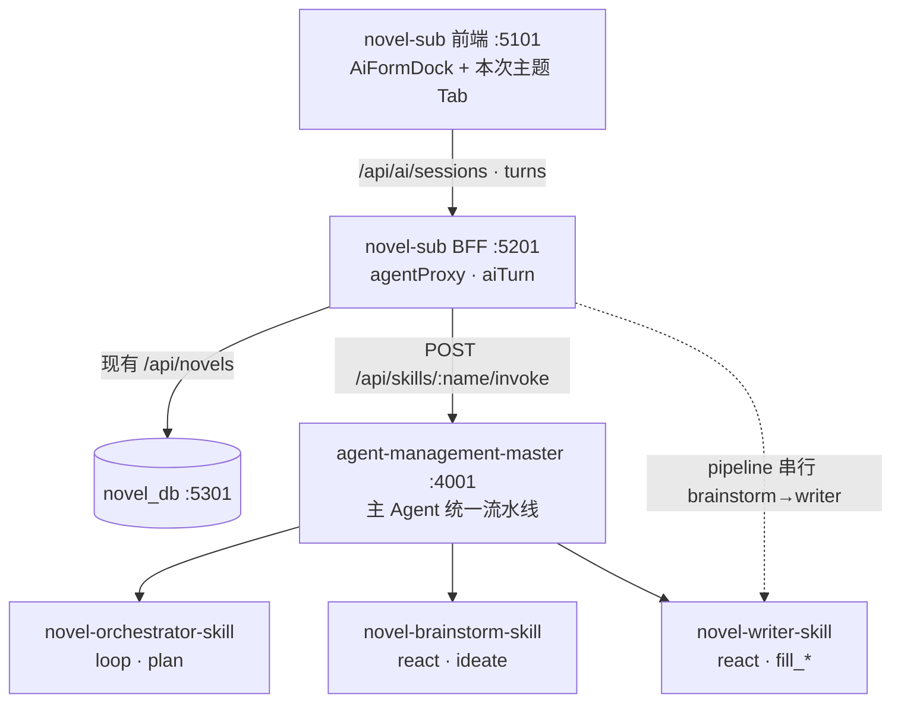

# novel-sub 架构关系图

> 子应用 `app_key=novel` · 菜单名「叙事工作台」· BFF `:5201` · Vite `:5101`

## 前端路由



| 路由 name | 路径 | 组件 | 说明 |
|-----------|------|------|------|
| `novel-list` | `/novels` | `NovelListPage.vue` | 看板 + 表格 |
| `novel-create` | `/novels/create` | `NovelCreatePage.vue` | 六步向导；Query：`?id=`、`?step=1..6`、`from=detail`、`autorun=settings` |
| `novel-detail` | `/novels/:id` | `NovelDetailPage.vue` | 六模块设定 + 单章开发；Query：`?tab=1..8`、`?chapter=` |
| `novel-qa` | `/novels/:id/qa` | `NovelQaPage.vue` | 验收核检；列表/详情进入，不占侧栏 |

嵌入主应用时 basename 为 `/media/novel`（Qiankun props）。

## BFF API



| 方法 | 路径 | 用途 |
|------|------|------|
| GET | `/api/novel-enums` | 类型树 / 题材 / 读者 / 篇幅 / 更新节奏 |
| GET | `/api/style-presets` | 风格预设。不写小说库 |
| PUT | `/api/novels/:id/style` | 记录或清除风格。不改正文 |
| GET | `/api/story-templates` | 故事模板。网文连载、短剧、漫剧剧本、游戏剧情 |
| GET/POST | `/api/novels/:id/dialogues` | 游戏剧情对话。没有选项时按顺序接下一句。其他类型拒绝 |
| POST | `/api/novels/:id/dialogues/:dialogueId/choices` | 添加分支。只能跳到同一任务的另一句 |
| DELETE | `/api/novels/:id/dialogues/:dialogueId/choices/:choiceId` | 删除一个选项 |
| PUT/DELETE | `/api/novels/:id/dialogues/:dialogueId` | 修改或删除一句台词。不改正文 |
| POST | `/api/novels/from-template` | 按模板创建草稿 |
| GET | `/api/novels` | 列表（分页/筛选；派生 `word_count` / `chapter_written` / `chapter_total` / `progress_percent`） |
| POST | `/api/novels` | 创建小说（步骤 1 草稿） |
| GET | `/api/novels/:id` | 详情 + `setting_json` + 派生进度 |
| PUT | `/api/novels/:id` | 更新基础字段（忽略手填 `progress_percent`） |
| PUT | `/api/novels/:id/setting` | 合并写入 `setting_json` 分块（不含正文） |
| GET | `/api/novels/:id/chapters` | 章节正文字数元数据 |
| GET | `/api/novels/:id/chapters/empty` | 空章 id 顺序列表 |
| GET | `/api/novels/:id/reader` | 按卷/章全书正文（预览/导出） |
| GET | `/api/novels/:id/chapters/:chapterId` | 单章正文 + 上一章结尾摘要 / 下一章钩子 / 目标字数 |
| PUT | `/api/novels/:id/chapters/:chapterId` | 保存单章正文 |
| GET | `/api/novels/:id/packages` | 故事包概览：章节发布状态、版本、术语、一致性、提升申请、下游视频。项目名和节点向视频 BFF 现读 |
| GET | `/api/novels/:id/packages/diff` | 对比两个已发布版本，不改快照 |
| POST | `/api/novels/:id/packages` | 发布不可变故事包。body：`chapter_ids`，可选 `script_ids`、`intent_ids`。不选时快照不含剧本和叙事分镜。禁用词阻断 |
| POST | `/api/novels/:id/consistency/run` | 按章节重跑检查。禁用词阻断，人名和组织只警告 |
| POST | `/api/novels/:id/terms` | 新增术语 / 禁用词 |
| DELETE | `/api/novels/:id/terms/:termId` | 删除术语 |
| GET | `/api/novels/:id/timeline` | 按章节顺序排列剧情事件，附带世界观年份 |
| PUT | `/api/novels/:id/timeline` | 给一个事件记年份，不改正文 |
| GET | `/api/novels/:id/plotlines` | 剧情线列表 |
| POST | `/api/novels/:id/plotlines` | 新建剧情线 |
| PUT | `/api/novels/:id/plotlines/:plotlineId` | 修改剧情线 |
| DELETE | `/api/novels/:id/plotlines/:plotlineId` | 删除剧情线 |
| POST | `/api/novels/:id/chapters/:chapterId/plotlines` | 绑定本章剧情线，不改正文 |
| GET/POST | `/api/novels/:id/members` | 项目成员。角色为作者、编辑、审核 |
| DELETE | `/api/novels/:id/members/:memberId` | 移出成员。还锁着章节时拒绝 |
| GET | `/api/novels/:id/locks` | 当前章节锁 |
| POST | `/api/novels/:id/chapters/:chapterId/lock` | 锁定本章 |
| POST | `/api/novels/:id/chapters/:chapterId/unlock` | 锁定人或作者解锁 |
| GET | `/api/novels/:id/activity` | 操作记录。不含正文 |
| GET/POST | `/api/novels/:id/snapshots` | 草稿快照列表和新建。列表不含正文 |
| POST | `/api/novels/:id/snapshots/:snapshotId/restore` | 回退草稿。不改已发布故事包 |
| GET | `/api/novels/:id/scripts` | 剧本列表 |
| POST | `/api/novels/:id/scripts/suggest` | 向 `novel-writer-skill` 要剧本建议，不落库 |
| POST | `/api/novels/:id/scripts` | 新建剧本 |
| PUT | `/api/novels/:id/scripts/:scriptId` | 修改剧本 |
| DELETE | `/api/novels/:id/scripts/:scriptId` | 删除剧本 |
| GET | `/api/novels/:id/intent-shots` | 叙事分镜。附带已对齐的视频镜头 |
| POST | `/api/novels/:id/intent-shots/suggest` | 向 `novel-writer-skill` 要叙事分镜建议，不落库 |
| POST | `/api/novels/:id/intent-shots` | 新建叙事分镜 |
| PUT | `/api/novels/:id/intent-shots/:shotId` | 修改叙事分镜 |
| DELETE | `/api/novels/:id/intent-shots/:shotId` | 删除叙事分镜 |
| POST | `/api/novels/:id/promotions/:promotionId/apply` | 把视频侧台词差异写入正文 |
| POST | `/api/novels/:id/promotions/:promotionId/reject` | 驳回，body：`reason` |
| GET | `/api/packages/:packageId?version=` | 视频侧拉取已发布快照 |
| POST | `/api/internal/promotions` | 视频侧提交提升 |
| POST | `/api/internal/downstreams` | 视频侧登记钉扎 |
| GET | `/api/internal/ops/summary` | 故事包数量、待处理提升、未关闭一致性问题 |
| GET | `/api/internal/ops/tasks` | 只读任务。不返回章节或对白原文 |
| POST | `/api/ai/dispatch` | 按计划任务再调目标 feature；`plan.bodies` 选空章并返回 `chapter_id`、`tab: 7`；`scope=settings` 只跑设定，无任务时 `{ done: true }` |
| DELETE | `/api/novels/:id` | 删除 |
| POST | `/api/novels/batch-delete` | 批量删除 |

### setting_json 结构

```json
{
  "world": { "era", "geography", "timeline": [] },
  "factions": [{ "id", "name", "kind", "alignment" }],
  "characters": [{ "id", "name", "role", "faction_id" }],
  "character_edges": [{ "id", "source", "target", "relation" }],
  "outline": { "volumes": [{ "groups": [{ "sections": [] }] }] },
  "chapters": [{ "id", "title", "faction", "order", "outline_ref" }]
}
```

章节正文不在 `setting_json`，而在表 `novel_chapter_bodies`，按 `novel_id + chapter_id` 单章读写。

## 数据库（枚举）



| 表 | 用途 |
|----|------|
| `genre_categories` | 小说类型一级分类 |
| `genre_subcategories` | 小说类型二级分类 |
| `theme_categories` | 题材标签（可多选，含热度） |
| `audience_categories` | 目标读者复合枚举 |
| `length_categories` | 篇幅与字数区间 |
| `update_paces` | 更新节奏 |
| `novel_themes` | 小说-题材多对多 |
| `novel_chapter_bodies` | 单章正文（按章拉取，不进设定接口） |

`novels.genre` / `novel_type` / `target_audience` / `update_cadence` 仍作为名称冗余字段，便于列表筛选；真源为外键。

## 关键前端模块

| 模块 | 路径 |
|------|------|
| 向导状态 | `composables/useNovelCreateWizard.js` |
| 详情状态 | `composables/useNovelDetail.js` |
| Schema / 校验 | `utils/novelCreateSchema.js` |
| 详情展示辅助 | `utils/novelDetail.js` |
| API | `services/novelService.js` |
| 魔幻森林主题 | `styles/variables.css` 等 |
| 创建 UI | `components/novel/create/*` |
| 详情 UI | `components/novel/detail/*` |
| 人物关系图 | `components/novel/create/CharacterRelationGraph.vue`（AntV G6，详情页 `readonly`） |

## 联调拓扑

```text
浏览器 :5100 (menu-master)
  └─ Qiankun → novel-sub :5101（或 /subapps/novel-app/ 经主应用 Vite 代理）
       └─ API → http://localhost:5201/api
```

## Agent 调用关系（首批已落地：会话 + turns + 步 1 坞）

> 详细设计：[Agent设计/readme.md](./Agent设计/readme.md) · 产品入口：[docs-project/小说平台Agent.md](../../../docs-project/小说平台Agent.md)

前端 **不直连** Agent 平台。BFF 按会话 `pipeline` 串行调用 Skill；平台主 Agent 只负责 scheme 执行。明细：[Agent设计/00-组件拆分.md](./Agent设计/00-组件拆分.md)



| 角色 | 职责 |
|------|------|
| 平台主 Agent | 选 scheme、resolveLlm、跑 Executor |
| brainstorm | 书名/立意/人物等第一道火花，不写表单 JSON |
| writer | 收成对齐 schema 的 `patch` |
| orchestrator | 产出对齐五步的 `tasks[]`，不写正文 |
| BFF | 唯一网关；会话落库；注入枚举；用户确认后仍走现有 PUT |
